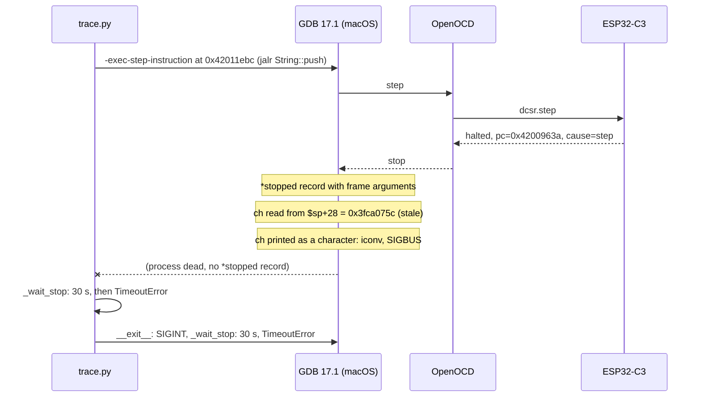

# Post-mortem: ESP32-C3 jsonrs, trial 0, 2 cables

The trial stopped on 2026-10-27 at seed 11 with `TimeoutError: C3 stop timeout: pc=0x42011ebc`, in
the first run and in all three resumes. No grammar was mined.

**Verdict: a real bug, in the configuration of the C3 jsonrs target (PR #73).** The C3 GDB crashes
when it prints the `char` argument of `alloc::string::String::push` at the function's first
instruction. The S3 jsonrs configurations of the same PR already avoid this with
`frame_arguments = "none"`; the C3 configurations do not set it. The board, the cables, the
firmware and the tracer's stepping work as intended.

## Summary

| Question | Answer | Status |
| --- | --- | --- |
| What stops? | GDB (`riscv32-esp-elf-gdb-no-python`, 17.1_20260402) dies with SIGBUS in macOS `iconv` | Confirmed |
| When? | On the stop record after the step into `String::push` (`0x4200963a`) | Confirmed |
| Why there? | GDB prints argument `ch` from a stack slot that the prologue has not written yet | Confirmed |
| Why only seed 11? | It is the first seed with a non-empty string, so the first that calls `String::push` | Confirmed |
| Why does the S3 pass? | Its configurations set `frame_arguments = "none"` | Confirmed (config) |
| Does `"none"` fix the C3? | Seed 11 traced past the crash point to the end of window 0 | Confirmed |
| Exact fault inside GDB or `iconv` | Not determined; it depends on the argument value | Open |

## Timeline

All times are AEDT (UTC+11), from [`run/runner.log`](run/runner.log),
[`run/trace.log`](run/trace.log) and the macOS crash reports
([`repro/gdb-crash-reports.txt`](repro/gdb-crash-reports.txt)).

| Time | Event |
| --- | --- |
| 05:58:42 | Runner starts `jsonrs:2-cables`, trial 0 |
| 06:00:32 | Tracing starts; seed 15 (`false`) and seed 9 (`""`) trace without error |
| 06:03:49.72 | Seed 11: GDB starts |
| 06:04:00–06:05:23 | Reads of input bytes 0 to 4 are recorded (` { "J`) |
| 06:05:36 | GDB crashes (crash report; GDB launched 06:03:49.7182) |
| 06:06:35 | 30 s stop timeout, then 30 s interrupt timeout; `trace.py` exits 1 |
| 06:07–06:17 | Three resumes, each reflashed; each GDB crashes at the same point (06:09:13, 06:12:50, 06:16:27) |
| 06:17:29 | Runner gives up; 18 of 20 seeds have no trace |

## Root cause



1. Seed 11 is ` { "J":[],"":false,"":null} `. After the parser reads `J`, `parse_string` calls
   `s.push(c)` (`json.rs:1009`). The call is the `jalr` at `0x42011ebc`.
2. The tracer steps one instruction. OpenOCD reports `Target halted, PC=0x4200963A,
   debug_reason=00000004` (single step done), 15 ms after the step command
   ([`repro/tracer-debug-excerpt.log`](repro/tracer-debug-excerpt.log)). The target and the
   tracer's step work.
3. GDB builds the `*stopped` record. With GDB's default `print frame-arguments scalars`, the
   record holds `self` and `ch`. rustc's debug information places them relative to the current
   `sp` (`info scope`: "frame base reg $sp offset 0+24" and "+28"). At the first instruction,
   `addi sp,sp,-64` has not run, so `$sp+24` and `$sp+28` are two words of the caller's frame:
   `0xa5a5a5a5` and `0x3fca075c` ([`repro/gdb-print-ch.txt`](repro/gdb-print-ch.txt)).
4. `0x3fca075c` is a stack address, not a Unicode scalar value. Printing it as a character makes
   GDB call the macOS `iconv`, which faults (`EXC_BAD_ACCESS`, SIGBUS, in
   `_citrus_UTF8_stdenc_mbtocsn`). GDB prints `Fatal signal: Abort trap: 6 ... A fatal error
   internal to GDB has been detected` and exits.
5. The tracer does not check whether GDB is still alive. It waits the full `timeout` (30 s) for a
   stop record, and then the same again in `__exit__`, where it sends SIGINT to the dead process.
   Both waits end in `C3 stop timeout`, which hides the crash.

The crash depends on the value. In the same traces GDB printed other invalid characters without
crashing, for example the argument of `next_pos` in seed 15 (`1070206656 '\x3fca0ec0'`). In GDB
with no target, `print (char32_t) 0x3fca075c` in C++ mode does not crash either. The crash needs
GDB's path for the Rust `char` type, a 4-byte `DW_ATE_UTF` base type printed while the language is
`c` (`GDB.language`). Which values crash, and why, was not investigated further; the fix does not
depend on it.

## What was ruled out

| Hypothesis | Test | Result |
| --- | --- | --- |
| Firmware hangs, restarts or runs out of heap in `String::push` | Seed 11 sent twice over UART with no debugger ([`repro/serial-only.txt`](repro/serial-only.txt)) | Accepted (`0x00`), no restart, no boot text between answers |
| Single step over `jalr` fails | DEBUG log of the repro | OpenOCD halts at `0x4200963A`, cause single step, after 15 ms |
| Trigger slot or watchpoint problem | DEBUG log; trigger readback after the crash | The step completes; all 8 slots read back free (`tdata1 = 0x23e00000`) |
| Flaky board, cable or host USB | Four runs plus one repro fail at the same pc and the same read count | Deterministic; the board answers normally after each reset |

## Fix

The fix belongs in PR #73, on `feat/esp32-c3-jsonrs`, because the C3 jsonrs target does not exist
on `main`. The pull request that adds this post-mortem targets that branch and carries the fix as
its own commit. Both C3 configurations get back the keys that commit `a99e6cbc` deleted (see
below), and this one:

```toml
# The ESP32-C3 GDB 17.1 dies (SIGBUS in macOS iconv) when it prints the char argument of
# String::push at its first instruction, before the prologue has written the argument's stack slot.
# The arguments are left out of the trace.
frame_arguments = "none"
```

The same commit drops trial 0's `language = "c"` from the C3 and S3 jsonrs configurations and uses
the desktop jsonrs expression instead: `watchpoint_type = ""` and `input_buffer = "data"`, so the
tracer evaluates `&data[3]`, which GDB's Rust parser accepts. This needs PR #78, merged into
`main`, where the backends stop wrapping the expression in a C cast. With both, seeds 9 and 15
traced on the C3 give the trial 0 traces entry for entry, apart from `function_args`, and on the
S3 give the trial 0 traces byte for byte ([`fix-check/`](fix-check/README.md)).

Trade-off: with `"none"`, `function_args` is empty in every C3 jsonrs trace, as it already is in
the S3 jsonrs traces. Nothing is lost for mining: no code in `src/miner/` or `src/cmimid/` reads
`function_args`. The values are also unreliable for Rust code: at the first instruction of a
function, which is where the tracer records them, GDB reads the arguments from the wrong stack
slots (step 3 above). Desktop jsonrs traces still carry argument values, so traces from the two
platforms differ in this field.

Alternatives that were not chosen:

- `frame_arguments = "presence"` prints `...` instead of values and also avoids the read. It
  keeps no more useful information than `"none"`, and the S3 configurations use `"none"`.
- A different GDB build (Linux host, or another macOS `iconv`) might not crash. It would make the
  evaluation depend on one host setup, and it does not make the argument values correct.

Validation: the failing configuration plus `frame_arguments = "none"`
([`repro/scripts/configuration.fixed.toml`](repro/scripts/configuration.fixed.toml)), seed 11
only. Window 0 (bytes 0 to 5) traced from the entry point (12:23:05) through the call to
`String::push` and on to the parser's return (12:36:17), with no GDB crash
([`repro/fixed-trace.log`](repro/fixed-trace.log)). The run was stopped after window 0 to free the
board; one window of seed 11 takes about 13 minutes, so the full seed would take about an hour.
The same window traced again with the final configuration, without `language = "c"`, passed the
`String::push` entry without a crash
([`fix-check/`](fix-check/README.md#seed-11-through-stringpush)).

## Other defects found

1. **Truncated C3 configurations on PR #73.** Commit `a99e6cbc` replaced `ignore_functions_regex`
   in `configuration.1-cable.toml` and `configuration.2-cables.toml` and deleted every key after
   it: `watchpoint_type`, `watchpoint_count`, `timeout`, `entrypoint`, `input_buffer`, the whole
   `[GDB.esp32c3]` table and `[LOGS]`. The first eval attempt failed on the missing keys
   (`KeyError: 'entrypoint'`). The eval ran on uncommitted, hand-restored copies.
   Restored in the same commit as `frame_arguments`.
2. **A dead GDB is reported as a stop timeout** (`src/tracer/instance/esp32_instance.py`, on
   `main`). `_wait_stop` and `_command` poll GDB's output until `timeout`, but never check
   `gdb_process.poll()`. Each crash costs 60 s and shows up as `stop timeout`, which pointed this
   investigation at the target first. The PR #73 S3 work met the same symptom ("the tracer spun on
   the dead pipe"). Fixed on `main` in PR #77: `_read_responses`, the read path of both waits,
   raises `RuntimeError: C3 GDB exited (SIGBUS)` once GDB has exited and its last records are
   drained.
3. **The runner resumes a deterministic failure.** Each resume reflashed and failed at the same pc
   after the same five reads; the three resumes took 11 minutes. A resume could stop when the same
   seed fails with the same error twice. This is in the eval runner, not in the repository.

## Commands

Board: ESP32-C3-DevKitM-1, adapter serial `A0:F2:62:01:70:28`, UART `/dev/cu.usbserial-11130`,
GDB port 3333, firmware `build-2/esp32-c3_jsonrs.ino.elf` as flashed by the eval (sha256
`50b72ec15bf1a87088374e56489595e6160215180e1143637be49117dcc79780`). Nothing was flashed.
The scripts in [`repro/scripts/`](repro/scripts/) are the ones that were run; their paths are
those of the session (`/tmp/c3pm`, the `feat-esp32-c3-jsonrs-c3` worktree). The commands below run
from the repository root.

```sh
S=docs/failed-evaluations/esp32-c3_jsonrs-trial-0-2-cables/repro/scripts
J=example_programs/json/seeds

# 1. Serial only, no debugger: does the firmware answer seed 11?
uv run $S/serial_check.py /dev/cu.usbserial-11130 $J/seed.15.in $J/seed.9.in $J/seed.11.in \
    $J/seed.19.in $J/seed.20.in $J/seed.11.in

# 2. The tracer on seed 11 only, DEBUG log; catch_hang.sh snapshots the processes during the hang.
#    repro.toml is run/configuration.toml with seed 11 only and log_level = "DEBUG".
uv run src/tracer/trace.py --config repro.toml \
    --adapter-serial A0:F2:62:01:70:28 --gdb-port 3333 --port /dev/cu.usbserial-11130

# 3. Manual GDB: serial reset, fresh OpenOCD, break at String::push, print the arguments
run_case.sh push-entry.gdb case-scalars.txt     # frame-arguments none survives; scalars crashes
run_case.sh push-ch.gdb case-ch.txt             # print ch alone crashes

# 4. The same GDB with no target: the value alone does not crash
riscv32-esp-elf-gdb -nx -batch -ex "set language c++" -ex "print (char32_t) 0x3fca075c"

# 5. Disassembly of the call and the callee
riscv32-esp-elf-objdump -d -C -l --start-address=0x42011e80 --stop-address=0x42011ed0 <elf>

# 6. The fix: step 2 with frame_arguments = "none" (configuration.fixed.toml)
```

## Files

| File | Content |
| --- | --- |
| `run/` | Logs of the failing run: `runner.log`, `errors.log` (all four tracebacks), `trace.log` (first attempt), `times.txt`, `state.txt`, `configuration.toml`, `git-status.txt` |
| `repro/serial-only.txt` | Step 1 |
| `repro/tracer-debug-excerpt.log` | Step 2: the last MI records before the hang |
| `repro/hang-snapshot.txt` | Step 2: process list during the hang (no GDB) |
| `repro/gdb-crash-reports.txt` | Summary of the seven macOS crash reports (four eval runs, three repros) |
| `repro/gdb-string-push-entry.txt`, `repro/gdb-print-ch.txt` | Step 3 |
| `repro/fixed-trace.log` | Step 6, window 0 of seed 11 |
| `repro/scripts/` | Scripts and the fixed configuration |
| `fix-check/` | Seeds 9 and 15 traced on both boards with the final configurations, compared with trial 0 |
