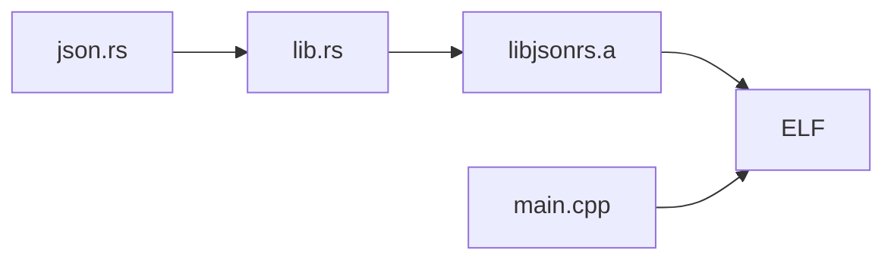

# ESP32-C3 jsonrs target

This target runs the paper's desktop Rust parser, [`json.rs`](../../example_programs/jsonrs/json.rs)
(tinyjson 2.5.1), with the corpora that the desktop jsonrs configuration names (`example_programs/json/{seeds,eval}`). It uses the same serial
protocol as the other C3 targets; see the [C3 setup README](../ESP32-C3%20DevKitM-1-N4X.md). The
firmware has not been built or run on hardware yet.

## How the parser gets onto the board

Arduino builds C and C++, so the parser is built as a static library and linked into the sketch:



- `rust/lib.rs` is a `#![no_std]` crate. It includes the desktop `json.rs` and provides what `std`
  gave it: a `std` module that re-exports `core` and `alloc`, a small `io::Write`, and a global
  allocator that calls newlib's `malloc` and `free`. The parser code is not rewritten.
- The only change to `json.rs` is that `main()` and its `std::env`/`std::fs` imports are skipped
  when the `jsonrs_firmware` cfg is set. The desktop build does not set it.
- `HashMap` becomes `BTreeMap`, because `core` has no hash map. Objects are iterated in key order,
  which changes the output of `stringify` but not which inputs are accepted.
- `jsonrs_parse` is the entry point. It does what the desktop `main()` does: parse, then
  `stringify`. A parse or stringify error returns `0xff` where the desktop panics with status 101.
- `utf8_valid` runs before the entry point. Input that is not UTF-8 is accepted, because the
  desktop `read_to_string` then fails and `main` still exits with status 0. The check stays outside
  the traced region, as the desktop reads and checks the file before it parses.

## Build the parser

Install the Rust target once, then build from the repository root:

```sh
rustup target add riscv32imc-unknown-none-elf

mkdir -p example_firmware/esp32-c3_jsonrs/build
rustc --edition 2021 --crate-type staticlib --target riscv32imc-unknown-none-elf \
  -g -C opt-level=0 --cfg jsonrs_firmware \
  -o example_firmware/esp32-c3_jsonrs/build/libjsonrs.a \
  example_firmware/esp32-c3_jsonrs/rust/lib.rs
```

`-g -C opt-level=0` match the desktop build, but the edition differs: the desktop `rustc` call defaults to 2015, the library needs 2021. The crate is named `lib`, so parser functions are `lib::json::JsonParser<...>`; the tracing regex relies on `json` appearing there and not in the shim or allocator. The `riscv32imc` target uses the same ABI (`ilp32`,
soft float) as Espressif's GCC for the C3.

## Build and upload

Follow the [C3 build and upload guide](../ESP32-C3%20DevKitM-1-N4X.md#build-and-upload) with
`TARGET=esp32-c3_jsonrs` and add this property to the `compile` command, so the linker takes the
library inside its group:

```sh
  --build-property "build.extra_libs=$PWD/example_firmware/esp32-c3_jsonrs/build/libjsonrs.a"
```

The expected ELF is `build-2/esp32-c3_jsonrs.ino.elf` for two cables and
`build-1/esp32-c3_jsonrs.ino.elf` for one cable.

## Tracing

Tracing starts at `jsonrs_parse` and watches the global `buf`. `ignore_functions_regex` extends the
desktop rule (skip every function whose name lacks `json`) by three groups: `parser`, `peekable`
and `core::str::(iter|validations)`. The backends drop reads that happen inside a function skipped
with `finish`, and tinyjson reads the input only through `Peekable::peek/next`, `Chars::next` and
`next_code_point`. GDB names these `core::iter::adapters::peekable::{impl#5}::peek`,
`core::str::iter::{impl#0}::next` and `core::str::validations::next_code_point`, so the type name
`Chars` is not a reliable match. The wrapper `parser` stays traced so that returning from
`jsonrs_parse` reaches the expected caller. Everything else is skipped.
As in the C3 json target, six watchpoints use slots 2-7 and slots 0-1 stay free for `finish`.

The traced code differs from the desktop in one respect: objects are `BTreeMap`s here and
`HashMap`s there, so the `json`-named generic instantiations traced for objects differ. Accepted
inputs do not, but the trace shape, and possibly the mined grammar, may.

`GDB.language = "c"` is needed because GDB switches to its Rust parser inside Rust frames, and that
parser rejects the C casts of the watchpoint expressions.

## Open points

Not checked yet, because no C3 was attached (the matching [S3 target](../esp32-s3_jsonrs/README.md)
was built and smoke-tested):

- That the library links: which `compiler_builtins` members the linker takes from `libjsonrs.a`
  instead of `libgcc`, ROM or newlib (grep the map for `libjsonrs.a(compiler_builtins`).
- The stack size: the parser is recursive, and the wrapper uses the 32 KiB loop-task stack of the
  calc target. The nesting depth that overflows it is not measured; an overflow or any other panic
  aborts the firmware, which the host sees as a restart and not as a rejection.
- That `finish` works out of Rust frames on the C3.
- Whether the serial oracle agrees with the desktop `jsonrs` on the corpus.
