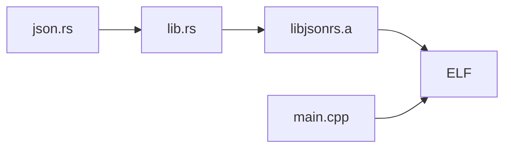

# ESP32-C3 jsonrs target

This target runs the paper's desktop Rust parser, [`json.rs`](../../example_programs/jsonrs/json.rs)
(tinyjson 2.5.1), with the desktop jsonrs seeds and evaluation inputs. It uses the same serial
protocol as the other C3 targets; see the [C3 setup README](../ESP32-C3%20DevKitM-1-N4X.md). The
firmware has not been built or run on hardware yet.

## How the parser gets onto the board

Arduino builds C and C++, so the parser is built as a static library and linked into the sketch:



- `rust/lib.rs` is a `#![no_std]` crate. It includes the desktop `json.rs` and provides what `std`
  gave it: a `std` module that re-exports `core` and `alloc`, a small `io::Write`, and a global
  allocator that calls newlib's `malloc` and `free`. The parser code is not rewritten.
- The only change to `json.rs` is that `main()` and its `std::env`/`std::fs` imports are skipped
  when the `jsonrs_firmware` cfg is set. The desktop build does not set it.
- `HashMap` becomes `BTreeMap`, because `core` has no hash map. Objects are iterated in key order,
  which changes the output of `stringify` but not which inputs are accepted.
- `jsonrs_parse` is the entry point. It does what the desktop `main()` does: parse, then
  `stringify`. A parse or stringify error returns `0xff` where the desktop panics with status 101.
  Input that is not UTF-8 is accepted, because the desktop `read_to_string` then fails and `main`
  still exits with status 0.

## Build the parser

Install the Rust target once, then build from the repository root:

```sh
rustup target add riscv32imc-unknown-none-elf

mkdir -p example_firmware/esp32-c3_jsonrs/build
rustc --edition 2021 --crate-type staticlib --target riscv32imc-unknown-none-elf \
  -g -C opt-level=0 -C panic=abort --cfg jsonrs_firmware \
  -o example_firmware/esp32-c3_jsonrs/build/libjsonrs.a \
  example_firmware/esp32-c3_jsonrs/rust/lib.rs
```

`-g -C opt-level=0` match the desktop build. The `riscv32imc` target uses the same ABI (`ilp32`,
soft float) as Espressif's GCC for the C3.

## Build and upload

Follow the [C3 build and upload guide](../ESP32-C3%20DevKitM-1-N4X.md#build-and-upload) with
`TARGET=esp32-c3_jsonrs` and add this property to the `compile` command, so the linker takes the
library inside its group:

```sh
  --build-property "build.extra_libs=$PWD/example_firmware/esp32-c3_jsonrs/build/libjsonrs.a"
```

The expected ELF is `build-2/esp32-c3_jsonrs.ino.elf` for two cables and
`build-1/esp32-c3_jsonrs.ino.elf` for one cable.

## Tracing

Tracing starts at `jsonrs_parse` and watches the global `buf`. `ignore_functions_regex` is the
desktop rule: skip every function whose name lacks `json` with `finish`, so `core`, `alloc`,
`malloc` and the Arduino runtime are not traced. As in the C3 json target, six watchpoints use
slots 2-7 and slots 0-1 stay free for `finish`.

## Open points

Not checked yet, because no board was attached:

- Whether the library links without duplicate symbols against `libgcc` (both provide soft-float
  helpers).
- Whether GDB's `ignore_functions_regex` matches the demangled Rust names (`json::JsonParser<...>`)
  as it does on the desktop; check with `info functions json` on the ELF.
- The stack size: the parser is recursive, and the wrapper uses the 32 KiB loop-task stack of the
  calc target. The nesting depth that overflows it is not measured.
- Whether the serial oracle agrees with the desktop `jsonrs` on the evaluation inputs.
