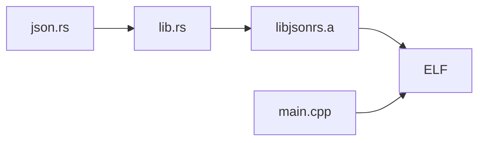

# ESP32-C3 jsonrs target

This target runs the paper's desktop Rust parser, [`json.rs`](../../example_programs/jsonrs/json.rs)
(tinyjson 2.5.1), with the corpora that the desktop jsonrs configuration names
(`example_programs/json/{seeds,eval}`). It uses the same serial protocol as the other C3 targets;
see the [C3 setup README](../ESP32-C3%20DevKitM-1-N4X.md). The firmware has been built and traced
on a C3-DevKitM-1, but no trial has completed yet; trial 0 stopped at seed 11 (see the
[post-mortem][postmortem]).

## How the parser gets onto the board

Arduino builds C and C++, so the parser is built as a static library and linked into the sketch:



- `rust/lib.rs` is a `#![no_std]` crate. It includes the desktop `json.rs` and provides what `std`
  gave it: a `std` module that re-exports `core` and `alloc`, a small `io::Write`, and a global
  allocator that calls newlib's `memalign` and `free`. The parser code is not rewritten.
- The only change to `json.rs` is that `main()` and its `std::env`/`std::fs` imports are skipped
  when the `jsonrs_firmware` cfg is set. The desktop build does not set it.
- `HashMap` becomes `BTreeMap`, because `core` has no hash map. Objects are iterated in key order,
  which changes the output of `stringify` but not which inputs are accepted.
- `jsonrs_parse` is the entry point. It does what the desktop `main()` does: parse, then
  `stringify`. A parse or stringify error returns `0xff` where the desktop panics with status 101.
- `utf8_valid` runs before the entry point. Input that is not UTF-8 is accepted, because the
  desktop `read_to_string` then fails and `main` still exits with status 0. The check stays outside
  the traced region, as the desktop reads and checks the file before it parses.

## Build the parser

Install the Rust target once, then build from the repository root:

```sh
rustup target add riscv32imc-unknown-none-elf

mkdir -p example_firmware/esp32-c3_jsonrs/build
rustc --edition 2021 --crate-type staticlib --target riscv32imc-unknown-none-elf \
  -g -C opt-level=0 --cfg jsonrs_firmware \
  -o example_firmware/esp32-c3_jsonrs/build/libjsonrs.a \
  example_firmware/esp32-c3_jsonrs/rust/lib.rs
```

`-g -C opt-level=0` match the desktop build, but the edition differs: the desktop `rustc` call
defaults to 2015, the library needs 2021. The crate is named `lib`, so parser functions are
`lib::json::JsonParser<...>`; the tracing regex relies on `json` appearing there and not in the
shim or allocator. The `riscv32imc` target uses the same ABI (`ilp32`, soft float) as Espressif's
GCC for the C3.

## Build and upload

Follow the [C3 build and upload guide](../ESP32-C3%20DevKitM-1-N4X.md#build-and-upload) with
`TARGET=esp32-c3_jsonrs` and add this property to the `compile` command, so the linker takes the
library inside its group:

```sh
LIB=$PWD/example_firmware/esp32-c3_jsonrs/build/libjsonrs.a
  --build-property "build.extra_libs=$LIB"
```

The expected ELF is `build-2/esp32-c3_jsonrs.ino.elf` for two cables and
`build-1/esp32-c3_jsonrs.ino.elf` for one cable.

## Tracing

Tracing starts at `jsonrs_parse` and watches its argument `data`, which points to the global `buf`.
`ignore_functions_regex` extends the desktop rule (skip every function whose name lacks `json`) by
three groups: `parser`, `peekable` and `core::str::(iter|validations)`. The backends drop reads that
happen inside a function skipped with `finish`, and tinyjson reads the input only through
`Peekable::peek/next`, `Chars::next` and `next_code_point`. GDB names these
`core::iter::adapters::peekable::{impl#5}::peek`, `core::str::iter::{impl#0}::next` and
`core::str::validations::next_code_point`, so the type name `Chars` is not a reliable match. The
wrapper `parser` stays traced so that returning from `jsonrs_parse` reaches the expected caller.
Everything else is skipped. As in the C3 json target, six watchpoints use slots 2-7 and slots 0-1
stay free for `finish`.

The traced code differs from the desktop in one respect: objects are `BTreeMap`s here and
`HashMap`s there, so the `json`-named generic instantiations traced for objects differ. Accepted
inputs do not, but the trace shape, and possibly the mined grammar, may.

The watch expression is the desktop's: `input_buffer = "data"` and `watchpoint_type = ""` give
`&data[3]`, which GDB's Rust parser accepts in the Rust frame. A C cast would not parse there, and
the C++ global `buf` is not visible from it.

`GDB.frame_arguments = "none"` is needed because the C3 GDB 17.1 dies when it prints the `char`
argument of `String::push` at its first instruction, where the argument's stack slot still holds
a stale value. `function_args` is therefore empty in the traces, as for the S3 target. See the
[trial 0 post-mortem][postmortem]. Trial 0 traced seeds 15 and 9 in full, so `finish` returns from
skipped functions into Rust frames.

[postmortem]: ../../docs/failed-evaluations/esp32-c3_jsonrs-trial-0-2-cables/README.md

## Runtime routines

`libjsonrs.a` contains Rust's `compiler_builtins`, which defines `memcpy`, `memset`, `strlen`, the
soft-float helpers and the 64-bit division that newlib, libgcc and the ROM also provide. None of
its code reaches the firmware. In both C3 maps (`build-1`, `build-2`) the linker pulls 46
`compiler_builtins` members, some for references from the Arduino core (`strlen` and
`__floatsidf` for `Print.cpp`, `memcpy` for `WString.cpp`), but every symbol they define is weak.
The strong definitions win: `memcpy`, `memmove` and `memcmp` from newlib in IRAM, and `memset`,
`strlen` and the libgcc helpers from the ROM addresses in `esp32c3.rom.libc.ld` and
`esp32c3.rom.libgcc.ld`. `--gc-sections` then discards all `compiler_builtins` code sections; the
ELF has no `compiler_builtins` symbol. To check a new build:

```sh
ELF=example_firmware/esp32-c3_jsonrs/build-2/esp32-c3_jsonrs.ino.elf
riscv32-esp-elf-nm -C $ELF | grep -c compiler_builtins  # 0
riscv32-esp-elf-nm $ELF | grep -w -e memcpy -e __adddf3  # IRAM (0x403...) and ROM (0x400...)
```

## Stack depth

The parser recurses once per nesting level: `parse_any` calls `parse_array` or `parse_object`,
which call `parse_any` for each element. `stringify` and the drop of the parsed value recurse as
well, with smaller frames. At `opt-level = 0` the frames in the ELF are (from each function's
`addi sp,sp,-N`):

| Frames | Bytes |
| --- | ---: |
| Loop task to the first `parse_any` (`vPortTaskWrapper`, `loopTask`, `loop`, `parser`, `jsonrs_parse`, `from_str`, `parse`, `parse_any`) | 768 |
| One array level (`parse_array` + `parse_any`) | 960 |
| One object level (`parse_object` + `parse_any`) | 1,216 |
| Innermost value, deepest direct-call path (`parse_number` into `core`'s float parser) | up to 2,672 |
| Interrupt frame saved on the task stack | 128 |

With the 32 KiB loop-task stack, 30 nested arrays or 23 nested objects fit on every direct-call
path, and the frames alone exceed the stack at 34 arrays or 27 objects. Indirect calls (`core::fmt`
in error messages) are not in this bound. The S3 build of the same library overflows its 32 KiB
loop-task stack between 29 and 30 nested arrays and between 23 and 24 nested objects (measured, see
the [S3 target](../esp32-s3_jsonrs/README.md#stack-depth)). The C3 depth has not been measured on
the board; this command finds it without a debugger:

```sh
uv run scripts/esp32_jsonrs_oracle.py depth --kind array \
  --config example_firmware/esp32-c3_jsonrs/configuration/configuration.2-cables.toml --port PORT
```

An overflow trips the hardware stack guard (`CONFIG_ESP_SYSTEM_HW_STACK_GUARD`), and the panic
handler restarts the chip (`CONFIG_ESP_SYSTEM_PANIC_PRINT_REBOOT`). The host does not see a
rejection: `ESP32SerialConnection.send_input` sends the input again after the restart and raises
after the second one, which stops the run. With a debugger attached, `CONFIG_ESP_DEBUG_OCDAWARE`
makes the panic handler halt the chip instead; how the tracer reports that stop is not tested. The
desktop does not overflow at this depth: built for
the host, `json.rs` accepts 1,023 nested arrays, the deepest nesting that fits in 2,048 bytes.
Every corpus input nests at most two levels deep (`example_programs/json` and
`example_programs/jsonrs`), so only generated inputs can reach the limit.

## Oracle check

`scripts/esp32_jsonrs_oracle.py corpus` compares, input by input, the desktop verdict (exit status
0 of `json.rs` built for the host) with the firmware's result byte. The firmware side is either the
host model in [`host/model.c`](host/model.c), which links `rust/lib.rs` built for the host behind
the length check of `loop()` and the UTF-8 check of `parser()`, or a board without a debugger,
through the tracer's own serial exchange. Results of 2026-10-29, with rustc 1.97.1 on macOS:

| Firmware side | Seeds accepted | Eval accepted | Inputs that differ |
| --- | ---: | ---: | ---: |
| Host model | 20 of 20 | 993 of 1,000 | 0 |
| S3 board (same `lib.rs`, Xtensa build) | 20 of 20 | 993 of 1,000 | 0 |
| C3 board | not run | not run | |

The seven rejected eval inputs are numbers that overflow to infinity, such as `-5e+690`;
`stringify` cannot print them, so the desktop panics and the firmware answers `0xff`. The model
also agrees on the `example_programs/jsonrs` corpora (20 and 1,000 inputs, all accepted). Inputs
of more than 2,048 bytes are a known difference: the firmware rejects them unread, the desktop
parses them. The corpora have none (the longest is 67 bytes).

The host model checks the library and the wrapper logic, not the C3 build: it runs on a 64-bit
host with a hardware FPU and an 8 MiB stack, where the C3 uses 32-bit `usize`, the ROM's
soft-float routines and the 32 KiB loop-task stack. Five
seeds sent to the C3 without a debugger were accepted, as on the desktop. Build the host binaries
and run the checks from the repository root:

```sh
B=example_firmware/esp32-c3_jsonrs/build/host
mkdir -p $B
rustc -g -C opt-level=0 -o $B/jsonrs example_programs/jsonrs/json.rs
rustc --edition 2021 --crate-type staticlib -g -C opt-level=0 -C panic=abort --cfg jsonrs_firmware \
  -o $B/libjsonrs.a example_firmware/esp32-c3_jsonrs/rust/lib.rs
cc -o $B/model example_firmware/esp32-c3_jsonrs/host/model.c $B/libjsonrs.a

uv run scripts/esp32_jsonrs_oracle.py corpus --desktop $B/jsonrs --model $B/model \
  example_programs/json/seeds example_programs/json/eval
uv run scripts/esp32_jsonrs_oracle.py corpus --desktop $B/jsonrs \
  --config example_firmware/esp32-c3_jsonrs/configuration/configuration.2-cables.toml --port PORT \
  example_programs/json/seeds example_programs/json/eval
```

The desktop build drops `-C target-feature=+crt-static` of the paper's Linux build, which macOS
does not support; the parser code is the same. The model's library needs `-C panic=abort`, as the
board builds have: rustc rejects unwinding panics in a `no_std` crate. `model.c` supplies the
`memalign` that the allocator calls and the unwinding personality that the host's prebuilt `alloc`
refers to.
