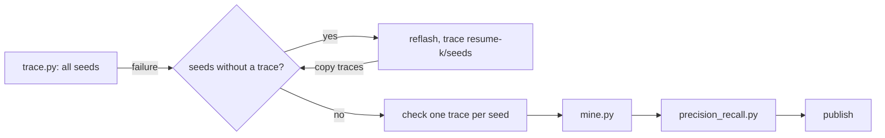
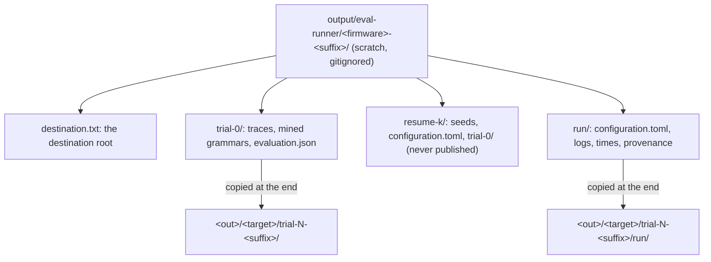

# ESP32 evaluation runner

The runner flashes, traces, mines and evaluates ESP32-C3 and ESP32-S3 configurations
(`example_firmware/esp32-*/configuration/*.toml`). It retries failed stages, resumes tracing with
the seeds that have no trace yet, and writes one result folder per configuration.

## Before you start

- Build the firmware of each configuration. The runner flashes the build next to the TOML's
  `binary_file` and reads the board (`fqbn`) from `build.options.json` in the same folder.
- Put `arduino-cli` on `PATH`.
- Connect one board. One run uses one debug adapter, so run C3 and S3 configurations separately.

## Usage

Start the runner from the repository root:

```sh
uv run python -m scripts.eval_runner [CONFIG...]
```

The runner asks for every input that you do not give as a flag. For example, to run the two C3
cgidecode setups without any questions:

```sh
uv run python -m scripts.eval_runner \
  example_firmware/esp32-c3_cgidecode/configuration/configuration.2-cables.toml \
  example_firmware/esp32-c3_cgidecode/configuration/configuration.1-cable.toml \
  --out evaluation/esp32-c3_applications \
  --adapter-serial A0:F2:62:01:70:28 --uart-serial 8afe88d078bcf0119b5f157148e9de0f \
  --gdb-port 3333 --yes
```

## Inputs

No input has a built-in default, because each depends on the machine or the campaign.

| Input                 | Flag               | Picker if the flag is missing                    |
| --------------------- | ------------------ | ------------------------------------------------ |
| Configurations        | positional paths   | Multi-select of `folder / file.toml`             |
| Destination root      | `--out`            | `evaluation/*_applications`, or "other path…"    |
| Debug adapter         | `--adapter-serial` | USB serial devices (path, serial, description)   |
| UART bridge           | `--uart-serial`    | Same list; only for `esp32-uart` configurations  |
| GDB port              | `--gdb-port`       | A number; another session may already use 3333   |
| Retries per failure   | `--max-retries`    | None (default 3)                                 |
| Stage timeout (hours) | `--stage-timeout`  | None (default 24)                                |
| Skip the preview      | `--yes`            | None                                             |
| Discard scratch state | `--fresh`          | None                                             |

In the configuration picker, Space toggles a configuration and Enter confirms.

The runner names each device by its USB serial number, not its path. It looks the path up again
before every stage, so a replug that moves `/dev/cu.usbmodem*` needs no new input. The values reach
`trace.py`, `mine.py` and `precision_recall.py` as `--port`, `--adapter-serial` and `--gdb-port`.
The repository TOML stays unchanged.

| Setup (`input_channel`)                    | `--port` (inputs, flashing) | `--adapter-serial`  |
| ------------------------------------------ | --------------------------- | ------------------- |
| C3 two cables (`esp32-uart`)               | The UART bridge (CP2102N)   | The native USB link |
| C3 one cable, S3 (`esp32-usb-serial-jtag`) | The native USB link         | The same device     |

Before it starts, the runner prints a preview and waits for Enter:

```text
example_firmware/esp32-c3_cgidecode/configuration/configuration.2-cables.toml -> evaluation/esp32-c3_applications/esp32-c3_cgidecode/trial-2-2-cables/
(run/ in each destination holds the logs and provenance)
output/eval-runner/esp32-c3_cgidecode-2-cables: continues, 7 traces kept
```

The target folder is the firmware folder, with `json` named `arduinojson` and `xml` named `libyxml`
as in `evaluation/stm32_applications`. The suffix comes from the TOML name. N is the highest
existing `trial-N-<suffix>` of that target and setup plus 1.

## Stages

The configurations run one after another, in the order given. Each one runs these stages:

1. **Flash** the build with `arduino-cli upload`. The runner always flashes first, as another
   configuration may have been flashed since.
2. **Trace** every seed with `trace.py`, and resume after a failure (see below).
3. **Check** that the traces pair with the seeds as `mine.py` pairs them: it sorts both lists and
   pairs them by position, so one trace per seed is not enough. A mismatch would give a wrong
   grammar.
4. **Mine** with `mine.py`.
5. **Evaluate** with `precision_recall.py --out <trial>/evaluation.json`.
6. **Publish**: copy the trial and `run/` to the destination, then delete the scratch folder.

A configuration that fails does not stop the others. At the end the runner prints a summary, and
the exit code is 1 if any configuration failed.

## Failures and retries

- A non-zero exit or a timeout is a failure. The runner retries it up to `--max-retries` times.
- Tracing retries reflash and trace only the missing seeds. Mining and evaluation retry whole.
- Retries count per failure: a trace retry that adds traces resets the count. A long run with
  rare stops continues; the same stop repeating gives up.
- Each stage runs in its own process group. A timeout or Ctrl-C stops the group: `trace.py` and
  the GDB, OpenOCD and serial worker it started. A second Ctrl-C waits until the group is gone.
  The runner never stops or waits for processes it did not start, and it does not check for other
  sessions that use the board.
- After a failure the runner checks the devices. If one is unplugged, it prints which one and asks
  you to type C after you plug it in. This failure does not count as a retry.
- A configuration or consistency error stops that configuration at once: a TOML that fails the
  checks of `trace.py`, no build, or traces that do not pair with the seeds.
- The runner does not work around failures. It does not change the firmware or the binary; it
  only records and retries.

## How a resume works

`trace.py` cannot skip seeds: it traces every seed of `seed_directory` into a new `trial-N` under
`output_directory`. So for a retry the runner:

1. finds the seeds without a complete `<seed>.trace` in the main trial. A trace that is not whole
   JSON (stopped while it was written) counts as missing;
2. copies them to `resume-k/seeds/`;
3. writes `resume-k/configuration.toml`, the repository TOML with `seed_directory` and
   `output_directory` pointing into `resume-k/`;
4. traces with it, and copies the new complete traces into the main trial.



`mine.py` and `precision_recall.py` read the latest `trial-N` of `output_directory`. The
generated `run/configuration.toml` points `output_directory` to the scratch folder, so they read
the merged trial.

The scratch state also survives a stop of the runner itself. Start it again with the same
configuration and it continues. It keeps the traces, and first copies complete traces that a
stopped resume left in `resume-k/`. It skips mining and evaluation if `times.txt` records exit 0
for them; their output files alone do not show that the stage finished. `--fresh` deletes the
scratch folder first.

## Folders



The destination is written only at the end, as `trial-N-<suffix>.partial` that is renamed when
the copy is complete. If a folder with the same N exists by then, N goes up and the summary prints
the final path. `evaluation.json` stays as `precision_recall.py` wrote it.

`run/` holds these files:

- `configuration.toml`: the generated TOML that the stages used.
- `flash.log`, `trace.log`, `resume-k.log`, `mine.log`, `eval.log`: the output of each stage. Each
  attempt starts with a `===` line and its command.
- `times.txt`: `<stage> exit=<code> seconds=<s>` per attempt; a stage stopped by Ctrl-C has
  exit 130.
- `failures.log`: each failure with the last lines of its log.
- `commands.txt`: the exact command line of every attempt.
- `provenance.txt`: per start, the git commit and status, the GDB, OpenOCD and Python versions,
  the GDB port, the USB serial numbers of the devices and `arduino-cli lib list`.
- `seeds.sha256`, `eval.sha256`: SHA-256 of the seed and evaluation files.
- `build.options.json`: the build options of the flashed firmware.
